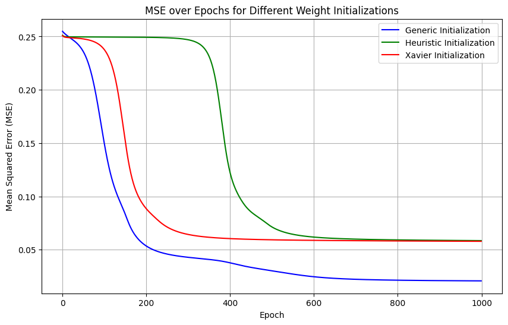

# Neural Network from Scratch

A fully connected neural network written with NumPy only, and a comparison of three ways to start its weights.

Individual coursework for CS190-3P, a third-year machine learning course at Mapúa Malayan Colleges Laguna, by Jherwin Indaya.

No machine learning library: forward propagation, sigmoid activations, backpropagation, and weight updates are written by hand. The network classifies fruits and vegetables from four one-hot encoded features (colour, shape, texture, and taste: 13 inputs) into two classes, on a 25-row course dataset.

## Results

The notebook compares three ways of starting the weights:

- **Generic:** uniform between −1 and 1.
- **Heuristic:** uniform between −0.3 and 0.3.
- **Xavier:** uniform between ±1/√(number of inputs).

On a 13-4-4-2 network trained for 1,000 epochs at a learning rate of 0.1, the final training error (mean squared error) was:

| Initialization | Final MSE |
| --- | --- |
| Generic | **0.021** |
| Xavier | 0.058 |
| Heuristic | 0.059 |

The heuristic weights sat on a plateau for about 350 epochs before learning, while the generic weights started improving almost at once. An earlier single-layer version, also in the notebook, labelled 8 of 10 hand-made test items correctly with each of the three initializations.

## Limits

The dataset is tiny and there is no random seed, so these numbers change from run to run. Treat them as a demonstration of the method, not a benchmark.

## Repository contents

| Path | Contents |
| --- | --- |
| `notebooks/neural_network_from_scratch.ipynb` | Data encoding, the network, training for each initialization, and the comparison. Outputs are kept. |
| `figures/` | The error comparison shown above. |

The course dataset is not included.

## How to run

1. Open the notebook with the **Open in Colab** badge above.
2. Put a CSV with `Color`, `Shape`, `Texture`, `Taste`, and `Class` columns in Google Drive at the path set in the Read Data cell.
3. Run the cells in order and allow the Drive mount when asked.

## License

The code and notebook are released under the [MIT License](LICENSE).
